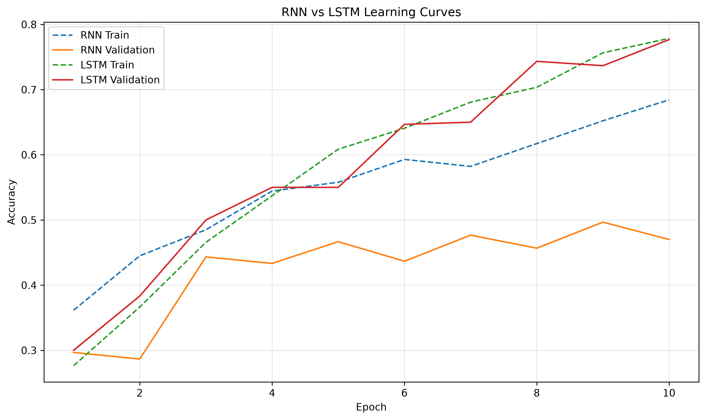
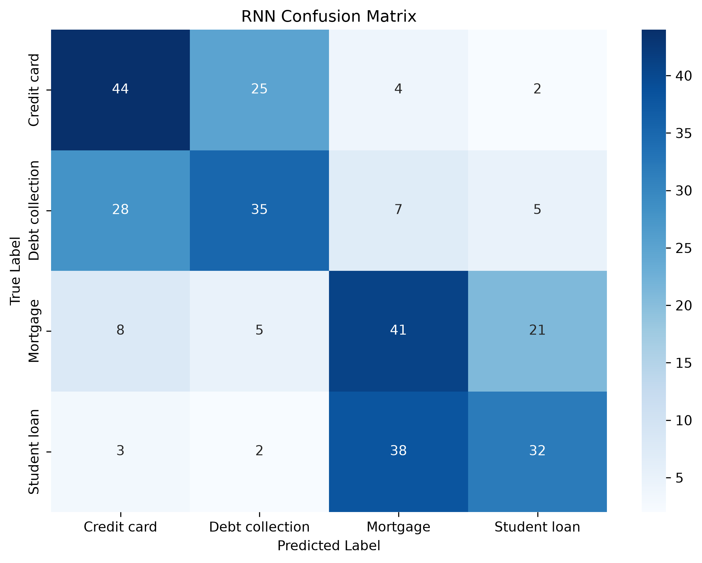
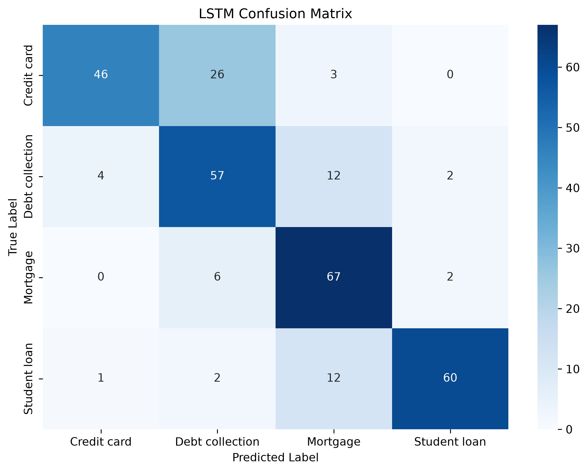

# Multi-Class Customer Complaint Classification with RNN and LSTM

## Project Overview

This project implements and compares Recurrent Neural Networks (RNNs) and Long Short-Term Memory (LSTM) networks for multi-class customer complaint classification using PyTorch and pre-trained GloVe word embeddings.

The objective is to investigate the effectiveness of recurrent neural architectures in classifying real-world financial consumer complaints.

## Key Features

- Real-world customer complaint data
- Text preprocessing and tokenization
- Pre-trained GloVe word embeddings
- Custom PyTorch Dataset and DataLoader
- RNN and LSTM architectures implemented in PyTorch
- CUDA-compatible training pipeline with CPU fallback
- Gradient clipping and Adam optimization
- Model checkpointing based on validation accuracy
- Performance evaluation and visualization
- Inference on unseen customer complaints

## Dataset

The dataset is sourced from the Consumer Financial Protection Bureau (CFPB) Consumer Complaint Database historical archive (December 2011–April 2018).

A balanced subset of 2,000 complaints was selected across four categories:

| Category | Samples |
|---|---:|
| Credit card | 500 |
| Debt collection | 500 |
| Mortgage | 500 |
| Student loan | 500 |
| Total | 2,000 |

### Data Split

| Dataset | Samples | Percentage |
|---|---:|---:|
| Training | 1,400 | 70% |
| Validation | 300 | 15% |
| Testing | 300 | 15% |

## Text Preprocessing

The preprocessing pipeline includes:

- Missing value removal
- Lowercase conversion
- Digit and punctuation removal
- Whitespace-based tokenization
- Vocabulary construction using training data
- Token-to-index conversion
- Sequence padding and truncation

## GloVe Embeddings

Pre-trained `glove-wiki-gigaword-50` embeddings were loaded using Gensim.

| Parameter | Value |
|---|---:|
| Vocabulary size | 9,436 |
| Embedding dimension | 50 |
| Matched vocabulary entries | 8,663 |
| Embedding coverage | 91.81% |
| Maximum sequence length | 100 |

## Model Architecture

Both models use the following architecture:

```text
Input Text
    ↓
Tokenization and Encoding
    ↓
Pre-trained GloVe Embedding Layer
    ↓
RNN / LSTM Layer
    ↓
Fully Connected Layer
    ↓
Four-Class Prediction
```

## Training Configuration

| Hyperparameter | Value |
|---|---|
| Hidden dimension | 64 |
| Batch size | 32 |
| Epochs | 10 |
| Learning rate | 0.001 |
| Optimizer | Adam |
| Loss function | Cross-Entropy Loss |
| Gradient clipping | 1.0 |
| Training device | CPU |

The best model checkpoints were selected based on validation accuracy.

## Results

### Test Set Performance

| Model | Accuracy | Macro Precision | Macro Recall | Macro F1 |
|---|---:|---:|---:|---:|
| RNN | 50.67% | 51.03% | 50.67% | 50.52% |
| LSTM | **76.67%** | **79.47%** | **76.67%** | **76.83%** |

The LSTM achieved a 26-percentage-point improvement in test accuracy over the vanilla RNN.

### Learning Curves



### RNN Confusion Matrix



### LSTM Confusion Matrix



### Per-Class F1 Scores

| Category | RNN | LSTM |
|---|---:|---:|
| Credit card | 0.5570 | 0.7302 |
| Debt collection | 0.4930 | 0.6867 |
| Mortgage | 0.4970 | 0.7929 |
| Student loan | 0.4741 | 0.8633 |

## Sample Predictions

| Input | LSTM Prediction | Confidence |
|---|---|---:|
| My credit card was charged twice for the same purchase. | Credit card | 84.55% |
| A debt collector keeps calling me about a debt I do not owe. | Debt collection | 81.70% |
| My mortgage company increased my monthly home loan payment. | Mortgage | 79.27% |
| I cannot afford to repay my student loans after graduation. | Student loan | 90.37% |

Confidence values represent maximum softmax probabilities rather than calibrated probabilities of correctness.

## Installation

```bash
git clone https://github.com/yungweiwang/customer-complaint-lstm.git
cd customer-complaint-lstm

python3 -m venv .venv
source .venv/bin/activate

pip install -r requirements.txt
```

Download the CFPB historical complaint archive and place the ZIP file in the `data/` directory.

Open `notebooks/complaint_classification.ipynb` in VS Code, select the virtual environment as the Jupyter kernel, and execute the notebook.

GloVe embeddings are downloaded through Gensim.

## Limitations and Future Work

- The experiment uses a relatively small, balanced dataset.
- Input sequences are truncated to 100 tokens.
- Static GloVe embeddings do not capture contextual word meanings.
- Results are based on a single experimental split and training run.
- The models have different parameter counts.
- Future experiments could compare BiLSTM, GRU, and Transformer-based architectures.
- Additional experiments could investigate gradient behavior and long-range dependencies.

## Conclusion

The experimental results demonstrate that the LSTM outperformed the vanilla RNN on the selected customer complaint classification task. Its gated architecture may contribute to improved sequence modeling, although further controlled experiments are needed to establish the underlying cause.

## Technologies

Python · PyTorch · RNN · LSTM · GloVe · Gensim · NumPy · Pandas · Scikit-learn · Matplotlib · Seaborn · Jupyter Notebook